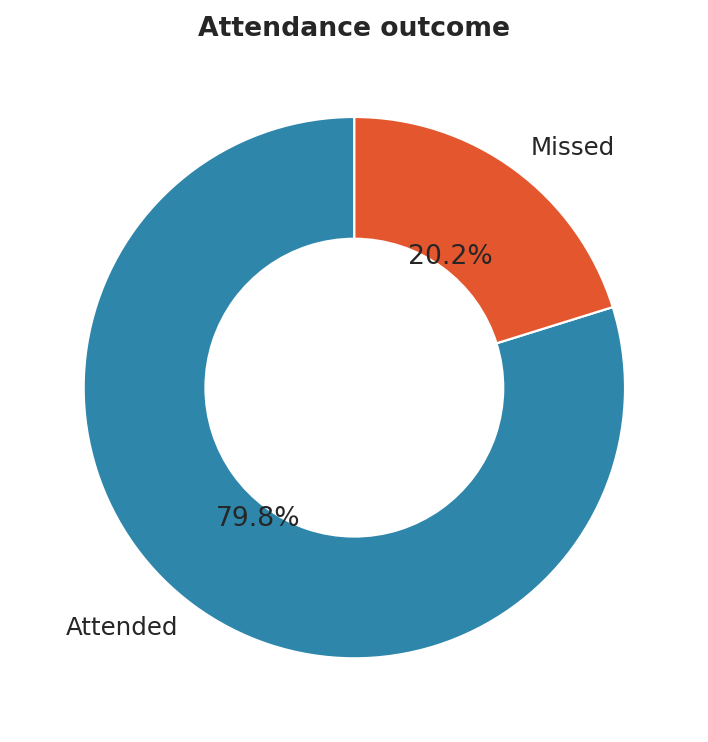
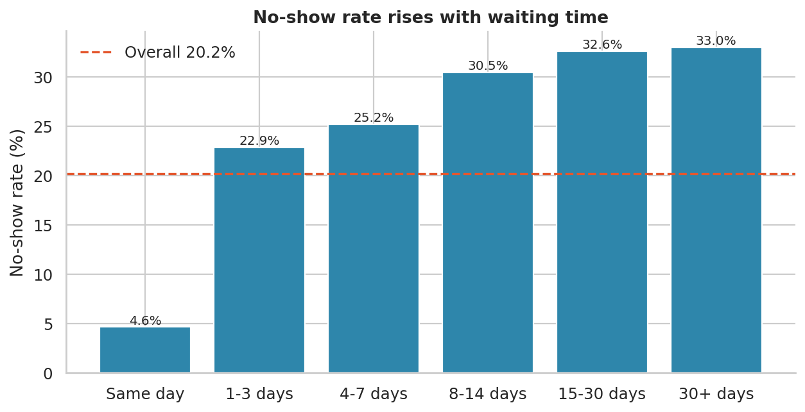
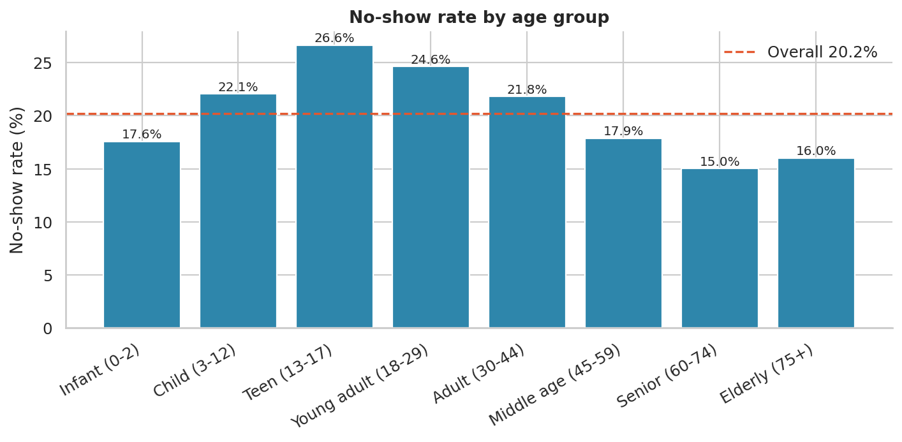
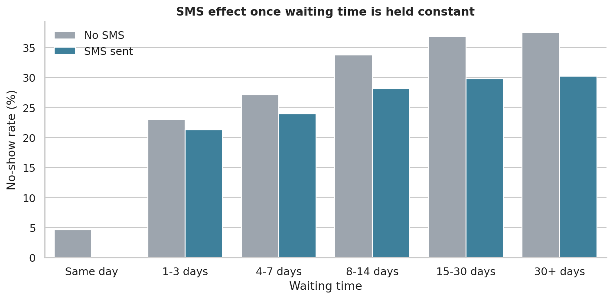
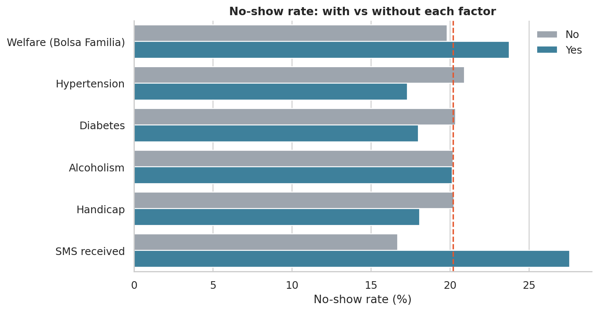
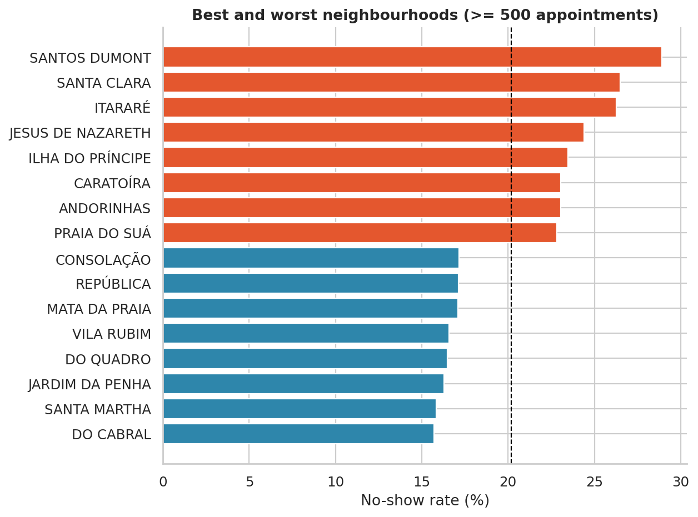
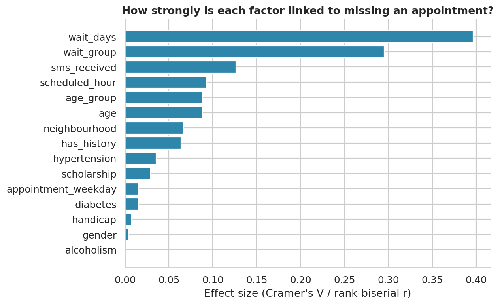
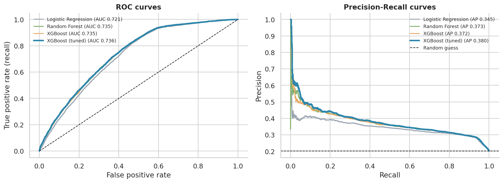
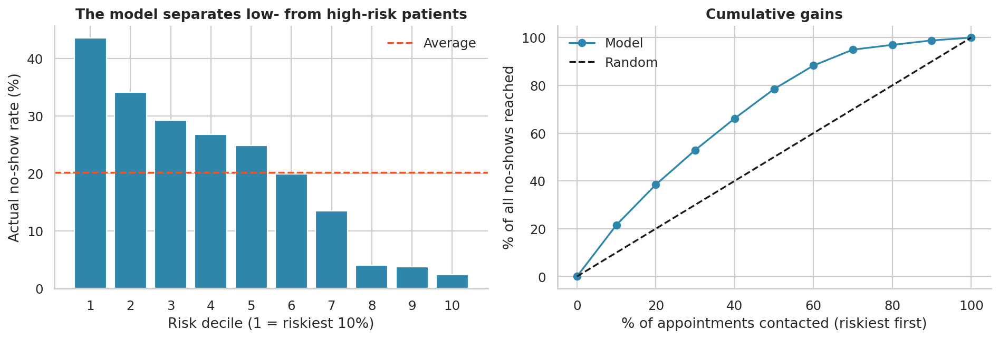
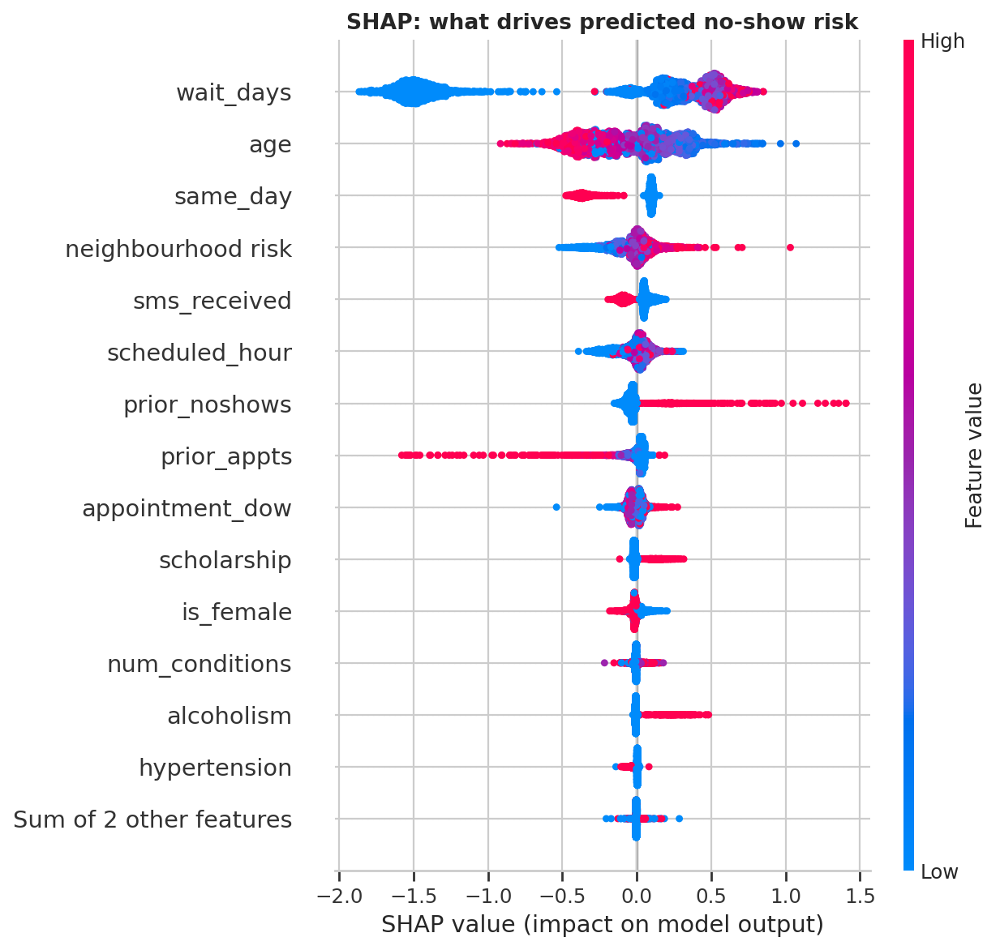

# 1. Executive summary

About **1 in 5 outpatient appointments (20.2%)** in this dataset was missed. Every missed slot is wasted clinician time and a longer wait for another patient.

The main findings are:

1. **Waiting time is the dominant factor.** Same-day appointments are missed 4.6% of the time, but appointments booked more than two weeks ahead are missed about **33%** of the time, roughly 7 times as often.
2. **Teenagers and young adults miss most** (about 25-27%); **seniors aged 60-74 are the most reliable** (15%).
3. **SMS reminders look harmful but are not.** Patients who received an SMS missed more (27.6% vs 16.7%), but only because reminders were sent mainly for long-wait appointments. Within every waiting-time band, patients with an SMS missed *less*.
4. **Gender, weekday and alcoholism have almost no effect on their own.**
5. A **machine-learning model** ranks appointments by risk with a ROC-AUC of about **0.74**. Contacting the riskiest 20% of appointments reaches about **38% of all no-shows** (random contact would reach 20%).
6. An **interactive Streamlit dashboard** lets staff explore the data, list high-risk appointments, score a single appointment, and estimate the value of a reminder programme.

**Recommendation in one line:** shorten booking waits where possible, and use the risk score to focus reminders, confirmation calls and easy rescheduling on the riskiest appointments, instead of treating all patients the same.

# 2. Data

| Item | Value |
|---|---|
| Source | Medical Appointment No-Shows (Kaggle), public hospitals in Vitoria, Brazil |
| Raw rows | 110,527 appointments |
| After cleaning | 110,521 appointments, 62,298 patients, 81 neighbourhoods |
| Appointment dates | 29 April to 8 June 2016 (bookings from November 2015) |
| Target | `missed` = 1 if the patient did **not** attend (recoded from the confusing raw `No-show` column) |

**Cleaning decisions**

- 1 row with age -1 and 5 rows with an appointment date before the booking date were removed.
- Patients aged **0 were kept** (3,539 real infants). Dropping them is a common mistake.
- The typos `Hipertension` and `Handcap` were fixed, and `Handcap` (0-4) became a yes/no flag.
- There were no missing values or duplicates.

**Engineered features:** waiting days, waiting and age groups, weekday, booking hour, number of conditions, and the patient's **prior appointments and prior no-shows**. The history features use only appointments that had already taken place on the booking day, so the model never sees information the hospital would not have had (no data leakage).

# 3. Exploratory analysis

## 3.1 Overall rate and waiting time

{width=45%}

{width=80%}

| Waiting time | Appointments | No-show rate |
|---|---:|---:|
| Same day | 38,562 | 4.6% |
| 1-3 days | 14,675 | 22.9% |
| 4-7 days | 17,510 | 25.2% |
| 8-14 days | 12,025 | 30.5% |
| 15-30 days | 17,371 | 32.6% |
| 30+ days | 10,378 | 33.0% |

## 3.2 Age and gender

{width=80%}

Teenagers (26.6%) and young adults (24.6%) are the riskiest groups; seniors 60-74 (15.0%) and the elderly 75+ (16.0%) are the most reliable. Gender makes essentially no difference (female 20.3%, male 20.0%).

## 3.3 The SMS paradox

{width=80%}

This is a textbook case of **confounding (Simpson's paradox)**. SMS reminders are almost never sent for same-day appointments (which have a very low no-show rate), and are mostly sent for long-wait appointments (which have a high one). Comparing all SMS and non-SMS patients therefore makes SMS look harmful. Within each waiting band, SMS patients miss 2 to 7 percentage points *less*. After adjusting for waiting time, age and other factors in a logistic regression, an SMS is associated with about **24% lower odds** of missing (odds ratio about 0.76).

*Caution:* this is observational data. Reminders were probably targeted at certain appointments, so it does not prove that SMS *causes* better attendance. An A/B test would be needed.

## 3.4 Health and social factors

{width=80%}

Patients with hypertension appear to attend more (17.3% vs 20.9%), but this is entirely an age effect: after adjusting for age and waiting time the effect disappears. After the same adjustment, diabetes and alcoholism are linked to *higher* risk (odds ratios about 1.16 and 1.36), and welfare-programme (scholarship) enrolment to about 23% higher odds of missing (raw rates 23.7% vs 19.8%). Alcoholism looks neutral in the raw numbers only because those patients are older; note that it is a small group, so its estimate is less precise.

## 3.5 Neighbourhoods

{width=75%}

Among 54 neighbourhoods with at least 500 appointments, rates range from about 16% (Do Cabral, Santa Martha, Jardim da Penha) to about 26-29% (Itarare, Santa Clara, Santos Dumont). Small neighbourhoods were excluded from the ranking because their rates are too noisy. The confidence intervals of the extreme large neighbourhoods do not overlap the national average, so these differences are real.

## 3.6 Statistical tests

Chi-square tests (categorical factors) and Mann-Whitney tests (age, waiting days, booking hour) were run for every factor. With 110,000 rows nearly everything is "significant", so **effect size** is what matters:

{width=75%}

Waiting time is the only factor with a large effect, and SMS (via targeting) has a medium effect. Booking hour, age, neighbourhood and patient history are small; gender, alcoholism, handicap and weekday are negligible. The full table is in `reports/statistical_tests.csv`.

# 4. Predictive model

## 4.1 Approach

- **Target:** `missed`. **Features:** only information known at booking time.
- **Split:** 80% train / 20% test, stratified (same no-show rate in both).
- **Neighbourhood** was encoded with a cross-fitted target encoder inside the pipeline, so the test set never influenced it.
- **Class imbalance** (80/20) was handled with class weights.
- **Models:** a dummy baseline, logistic regression, random forest and XGBoost; XGBoost was then tuned with randomized search.
- Accuracy is misleading here (a model that always predicts "attends" scores 79.8%), so models were compared on **ROC-AUC** and **PR-AUC**, with recall, precision and F1 shown for context.

## 4.2 Results (held-out test set, 22,105 appointments)

| Model | ROC-AUC | PR-AUC | Recall | Precision | F1 |
|---|---:|---:|---:|---:|---:|
| Dummy (always attends) | 0.500 | 0.202 | 0.000 | 0.000 | 0.000 |
| Logistic regression | 0.721 | 0.345 | 0.865 | 0.299 | 0.444 |
| Random forest | 0.735 | 0.373 | 0.791 | 0.317 | 0.452 |
| XGBoost | 0.735 | 0.372 | 0.821 | 0.310 | 0.450 |
| **XGBoost (tuned)** | **0.736** | **0.380** | 0.804 | 0.313 | 0.451 |

{width=95%}

**Robustness.** Patients appear more than once, and 60% of test appointments belong to a patient who is also in the training set. To check this does not inflate the score, the model was re-evaluated with a **patient-grouped 5-fold cross-validation (ROC-AUC 0.740)** and a **time-based split** (train on earlier dates, test on the latest: ROC-AUC 0.731). Both are close to the random-split score of 0.736, so the result is trustworthy.

**Calibration.** Class weights inflate raw probabilities, so a calibration step was added. The Brier score improved from 0.209 to 0.143 while the ranking stayed the same. The dashboard shows calibrated probabilities.

## 4.3 Business value

{width=95%}

The riskiest 10% of appointments are missed 43.5% of the time (lift 2.2x), while the least risky 30% are missed only about 2-4%. Contacting the riskiest **20%** of appointments reaches **38%** of all no-shows, and the riskiest 50% reach about 78%.

The model is clearly useful for **prioritising outreach**, but it is a moderate predictor (AUC 0.74), not a crystal ball.

## 4.4 What drives the predictions

{width=80%}

By average SHAP impact the top drivers are **waiting days**, **age**, **same-day booking**, **neighbourhood**, **SMS received**, **booking hour** and **prior no-shows**.

# 5. Dashboard

The Streamlit dashboard (`dashboard/app.py`) has seven tabs:

| Tab | What it offers |
|---|---|
| Overview | KPIs, weekly trend, rate by waiting time and weekday |
| Patient factors | Age, gender, health flags, SMS paradox chart, age x waiting heatmap |
| Neighbourhoods | Ranked areas with an adjustable minimum-volume filter |
| Risk model | Model metrics, risk deciles, SHAP, downloadable high-risk appointment list |
| Risk calculator | Score one appointment, get suggested actions and a waiting-time what-if curve |
| Impact simulator | Estimate the net benefit of a targeted reminder programme from your own cost assumptions |
| Data | Filtered data, CSV download, data dictionary |

All tabs respond to the sidebar filters (dates, neighbourhood, gender, age, waiting time, SMS, scholarship).

# 6. Recommendations

1. **Shorten the wait.** Offer earlier slots or a waiting list that moves patients forward; long waits are the biggest single driver.
2. **Target reminders.** Use the risk score so that high-risk appointments get a second reminder, a confirmation request or a phone call, while low-risk patients get the standard SMS.
3. **Make rescheduling effortless.** A one-tap cancel or reschedule link frees the slot for someone else.
4. **Use controlled overbooking only in high-risk slots**, with a waitlist backup so patients are not delayed.
5. **Focus on young adults and the high-rate neighbourhoods** for outreach, and ask them why (transport? cost? work hours?).
6. **Run an A/B test** of reminders on long-wait appointments. This is the only way to measure the real effect of SMS.

# 7. Limitations and ethics

- Only about **six weeks** of appointments are covered, so patient history is shallow. A hospital with years of records would likely see stronger history effects.
- There is **no information** on appointment type, doctor, reason for visit, distance, weather or transport.
- All results are **associations**, not causes.
- Age, gender and welfare status are sensitive. The model should be used only to **add support** (reminders, easier rescheduling) and **never to deny, delay or penalise care.**
- A different hospital or country would need its own validation before using this model.

# 8. Reproducibility

```
pip install -r requirements.txt
bash run_all.sh                # runs notebooks 01-03 then starts the dashboard
streamlit run dashboard/app.py # dashboard only
```

Fixed random seed (42) is used everywhere, so results are reproducible.
